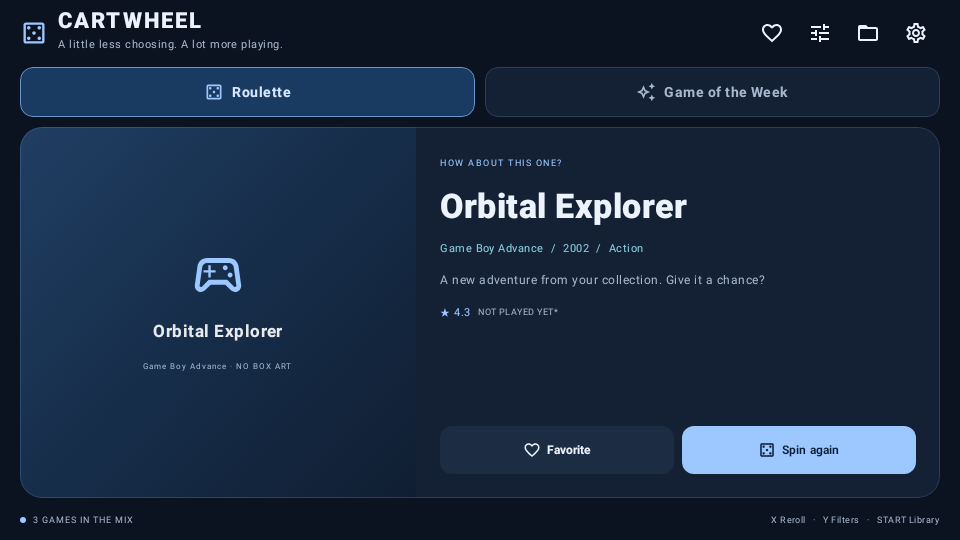
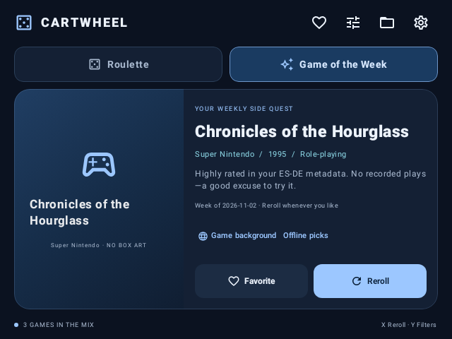
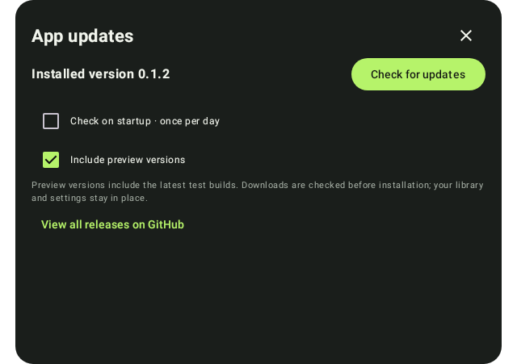

# Cartwheel

**A little less choosing. A lot more playing.**

A native Android game roulette for retro handhelds, with an online weekly advisor and offline roulette. Designed for landscape screens from 4:3 to 16:9, with touch and D-pad navigation.




Screenshots use a fictional test library. Your downloaded artwork appears after linking your folders.

## First setup

1. Install the debug APK on your handheld and open **Cartwheel**.
2. Choose **Connect your library**.
3. Select an import mode:
   - **ES-DE gamelists**: choose your `ES-DE` folder, or its `gamelists` folder. Reads names, descriptions, genres, ratings, favorites, hidden status and play counts.
   - **Scan ROM folders**: choose the parent folder containing your systems, such as `ROMs/nes`, `ROMs/snes`, and `ROMs/psx`. Subfolders inside each system are scanned too.
4. For artwork, select the `ES-DE` folder or select `downloaded_media` separately. Modern ES-DE normally stores media separately from gamelist XML.
5. Tap **Build my library**. After adding or removing games, open **Library & folders** and rescan.

Folder access uses Android's system picker with persistent **read-only** access. No broad storage permission, account, or subscription is required. Roulette works offline; the weekly advisor optionally uses internet access. Android may prevent selecting an entire SD card or internal storage root; choose a folder inside it. Changing the SD card or moving a selected folder may require selecting it again.

Expected layout:

```text
ROMs/
  snes/Chrono Trigger.sfc
  psx/Final Fantasy VII.m3u
ES-DE/
  gamelists/snes/gamelist.xml
  gamelists/psx/gamelist.xml
  downloaded_media/snes/covers/Chrono Trigger.png
```

**Selecting your ES-DE folder is enough for the default artwork layout.** Cartwheel finds `downloaded_media` automatically. A separate artwork folder is only needed if you keep media somewhere else. Matching uses system names and physical ROM filenames, including region tags and subfolders; scraped display names do not affect matching. Preference order: covers, 3D boxes, miximages, screenshots, title screens. The importer stops checking lower-priority media after finding a match and avoids unrelated media folders. It also handles ES-DE's directory-based game naming. Legacy `<image>` and `<thumbnail>` paths are supported when reachable inside a granted folder. Selecting the optional ROMs folder also helps resolve legacy images stored beside ROMs. A placeholder appears when artwork is missing or unavailable. See [ES-DE's media naming documentation](https://gitlab.com/es-de/emulationstation-de/-/blob/master/USERGUIDE.md#manually-copying-game-media-files).

## Find something to play

- **Roulette** draws equally from eligible games. It works through the pool before repeating and avoids the current game when alternatives exist. The draw history survives app restarts.
- **Yes, this one** saves a game to your Cartwheel play list. It does not open an emulator or modify ES-DE's gamelists.
- **Skip** picks another game.
- **Game of the Week** can use online review data without personal ratings. Opening the weekly tab downloads a shared catalog of Metacritic scores recorded in Wikidata, cached for seven days and matched to your library locally. Exact normalized titles/aliases and systems must match; ambiguous titles are skipped. Platform-specific scores take priority. Unspecified editions are clearly marked, and multiple unspecified scores are shown as a range. Coverage is limited, especially for older systems. Eligible matches scoring at least 75/100 get priority; if there are none, you receive a discovery pick. Every fourth reroll explores the wider library. Scraped ratings and no recorded plays are also selection signals.
- **Game background** searches Wikipedia for the picked game and shows attributed excerpts with links to the original articles. Search results let you check the title and edition. This lookup supplies context, not review scores. It requires internet access when used.
- **Reroll whenever you like.** The weekly replacement persists across restarts. A new week starts on Monday using the handheld's local date. Changing filters can change the eligible weekly pick.
- **Filters** let you exclude individual systems, choose a genre, and limit the mix to favorites or unplayed games. They apply to roulette and weekly picks. ES-DE hidden games are always excluded.
- **Retro / Clean** changes accent colors and typography. Both are lightweight, with no shaders or expensive CRT effects.

Online scores are enabled by default and can be disabled in Settings. A failed refresh keeps the saved catalog; discovery picks work without a connection. The catalog request does not upload your library, ROMs or artwork. Wikipedia receives the title you choose to search. No API keys are embedded or required. Wikidata scores can be incomplete or outdated; the app links to the exact source item. Wikipedia excerpts are attributed to Wikipedia contributors under CC BY-SA 4.0.

## Update from the handheld

Open the **gear icon → Updates → Check for updates**. This works before connecting a game library. The page shows your installed version, the last successful check, release notes and a download button when a newer APK is available.

**Include preview versions** is enabled for these early test builds. **Check on startup** is optional and off initially; when enabled it checks at most once per day after a successful check. No GitHub account or token is needed because the repository is public.

Tap **Download update**, wait for verification, then **Install update**. Android may first ask you to allow installations from Cartwheel; return to the app and tap Install again after allowing it. Android always asks you to approve the update. Library settings and folder access are preserved during an ordinary app update.



The downloader uses Android's download service and resumes after reopening the app. Before offering installation, Cartwheel checks the GitHub asset's SHA-256 digest, APK package name, version, minimum Android requirement and signing certificate. Errors provide a retry path and a link to all releases on GitHub. A release must have a standard version tag (such as `v0.1.2`), a `Cartwheel-*.apk` asset and GitHub's SHA-256 asset digest. Its APK version name must match the tag.

“Unplayed” means zero ES-DE play count and not saved to your Cartwheel play list. A ROM-only scan cannot know your emulator play history. Missing metadata is treated as unknown/zero; ratings are never invented. Imported favorites remain favorites; Cartwheel can add its own favorites locally.

Controller controls: D-pad to move focus, confirm button to activate the focused control, Back to dismiss dialogs, **X** to reroll, **Y** for filters, **Start** for library setup. X/Y labels refer to Android's button key codes; physical labels can differ between handhelds.

ROM scans recognize common cartridge, disc, arcade archive and handheld formats. M3U, CUE and GDI references suppress duplicate disc/track entries. Archives are treated as one game and are not unpacked. Obvious artwork, BIOS and save folders are ignored, as are directories containing `noload.txt`. Arbitrary executable bundles and every emulator-specific folder format are not automatically inferred; use ES-DE import for those libraries. Gamelist imports reflect ES-DE's saved catalog, including entries whose ROMs may have been moved; rescan ES-DE first to remove stale entries.

## Build

Requires JDK 17+, Android SDK platform 35 and build tools 35.0.0. Supports Android 8.0 and newer (API 26+); the app targets API 35 and can be installed on Android 16.

Open the folder in Android Studio, let it install the required SDK, and build, or run:

```powershell
.\gradlew.bat assembleDebug testDebugUnitTest lintDebug
```

On Windows, `scripts/setup-android.ps1` installs Google's command-line SDK into the ignored `.tools` folder and writes `local.properties`. It requires internet access and accepts Android SDK licenses. `scripts/build.ps1` uses a project-local temporary folder, avoiding long-path problems in Java's Windows socket implementation.

On macOS/Linux:

```sh
chmod +x gradlew
./gradlew assembleDebug testDebugUnitTest lintDebug
```

Output: `app/build/outputs/apk/debug/app-debug.apk`. This is a development APK signed with the build machine's debug key. Keep that key for compatible updates, or uninstall the old build before installing a build signed on a different machine (which clears Cartwheel's local settings). ROMs and ES-DE files are untouched.

GitHub Actions builds, tests, checks lint and uploads a debug APK. Official preview releases retain the original preview signing key in the ignored `.tools/signing/cartwheel-preview.keystore`; the local build uses it when present. Keep this key private and retain it for future releases. CI's temporary debug key is for build validation. The updater accepts APKs signed with the same key as the installed app. Production signing and store publishing are intentionally not configured.

## Validation

The project includes tests for gamelist metadata, entity rejection, filters, repeat avoidance, weekly persistence inputs, Monday boundaries and disc references. Robolectric screen tests render landscape 4:3 and 16:9 layouts and exercise setup and appearance. Real handheld testing is still required for SD-card providers, device-specific controller mappings, very large libraries and Android 16 behavior.

## Planned together

Potential additions after handheld feedback: a searchable library browser, adjustable recommendation weights, richer themes, a challenge log, cross-device settings export, and optional emulator launching. No game files or scraped commercial box art are included in this repository.
